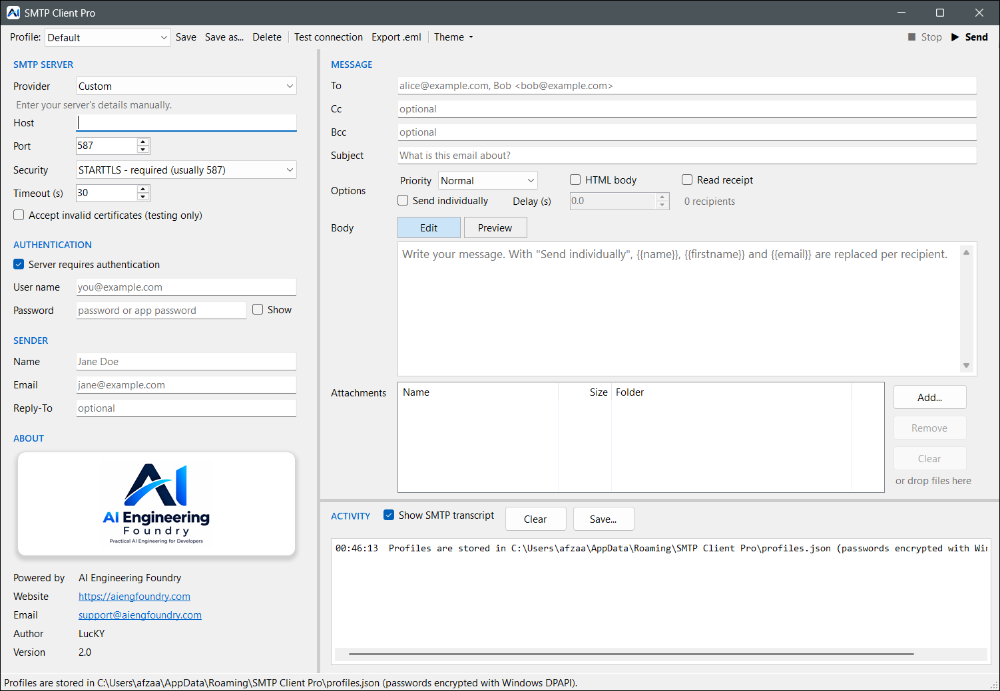
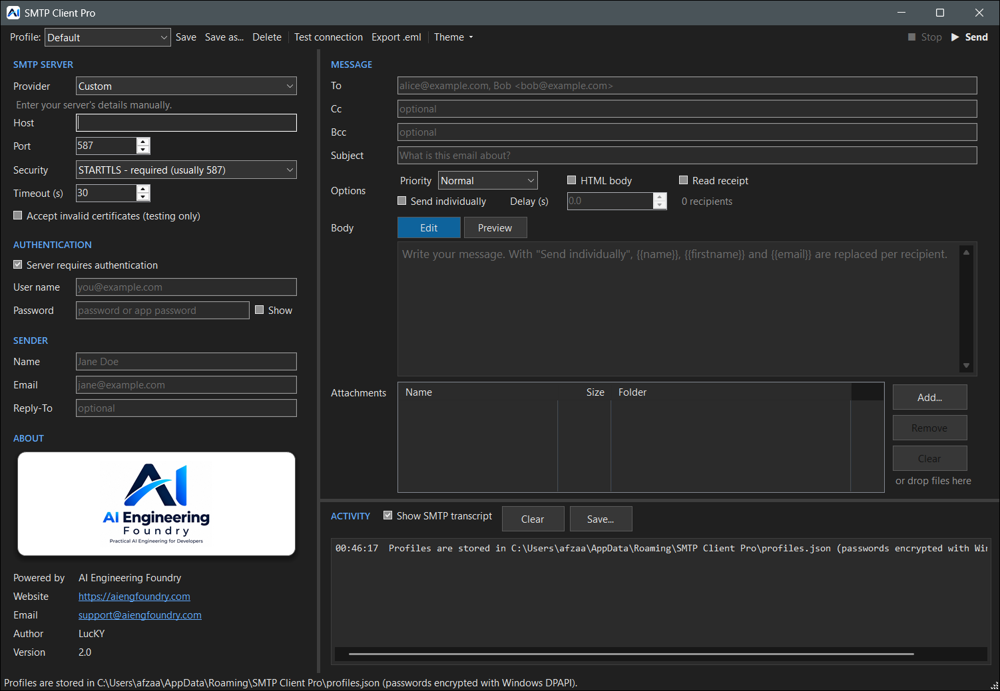
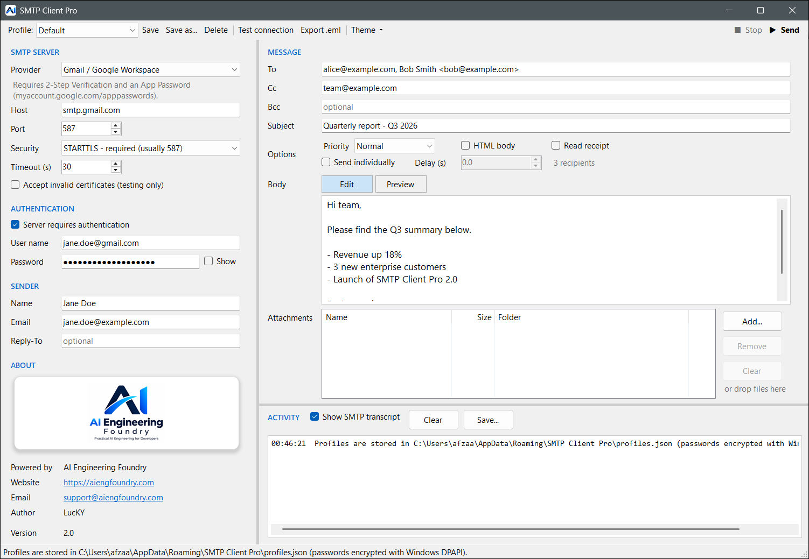
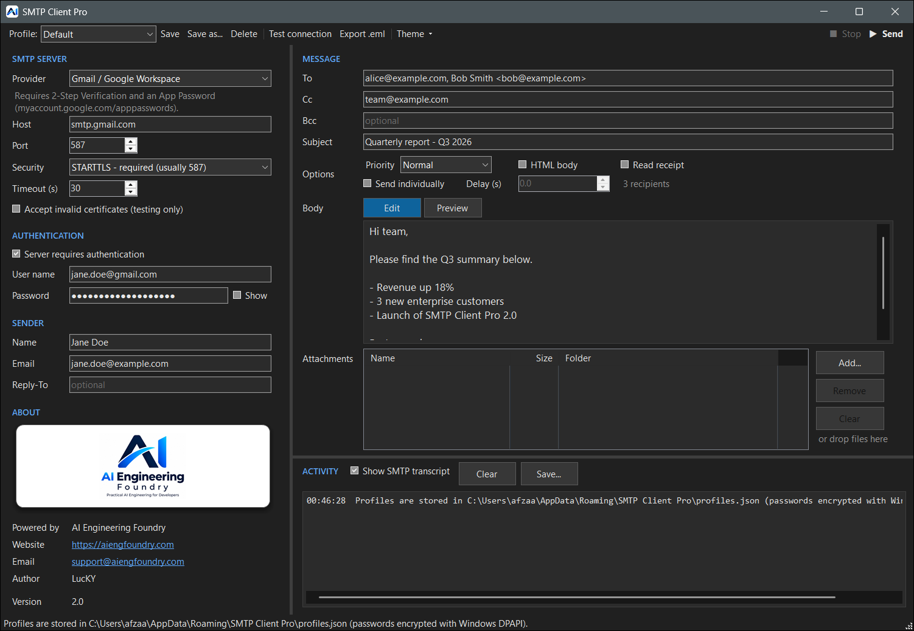
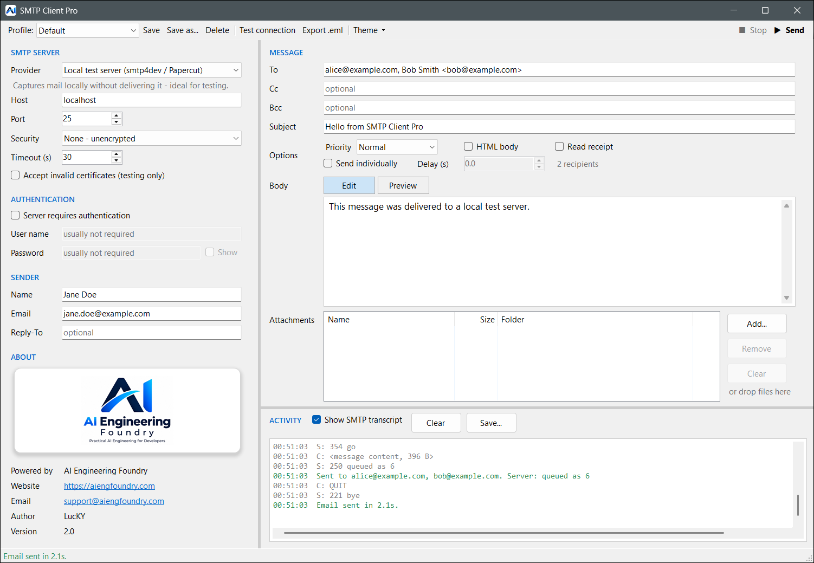
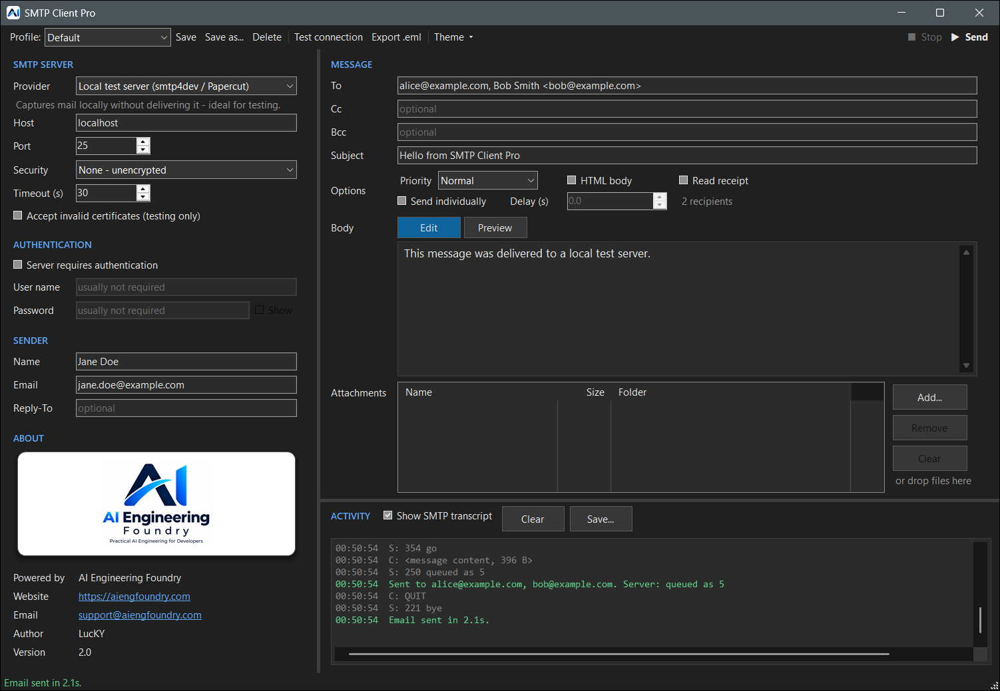
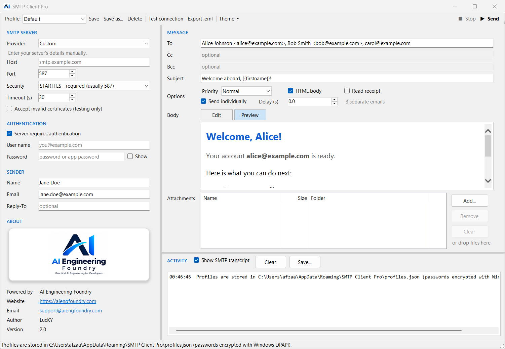
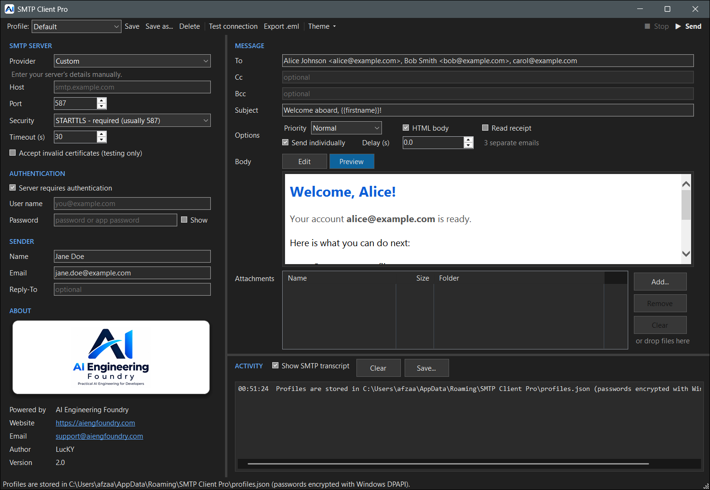

<p align="center">
  
</p>

<h1 align="center">SMTP Client Pro</h1>

<p align="center">
  A Windows desktop app for composing, sending and debugging email over SMTP.<br/>
  Version 2.0 · .NET 8 · Windows Forms · MailKit
</p>

<p align="center">
  
  
</p>

---

## Contents

- [Features](#features)
- [Screenshots](#screenshots)
- [Getting started](#getting-started)
- [Using the app](#using-the-app)
- [Provider presets](#provider-presets)
- [Troubleshooting](#troubleshooting)
- [Building from source](#building-from-source)
- [Project structure](#project-structure)
- [Data and security](#data-and-security)
- [Credits](#credits)

## Features

**Connection**
- Presets for Gmail, Outlook / Microsoft 365, Yahoo, iCloud, Zoho, SendGrid, Mailgun, Amazon SES and local test servers.
- Every security mode: Auto, implicit SSL/TLS (465), STARTTLS required (587), STARTTLS if available, and unencrypted. The app warns when the port and security mode don't match.
- Optional authentication, configurable timeout (5–600 s), and an "accept invalid certificates" switch for test servers.
- **Test connection** connects and authenticates without sending anything, then reports the TLS version, supported auth methods and the server's maximum message size.

**Composing**
- To, Cc, Bcc and Reply-To, separated by commas, semicolons or new lines (`alice@example.com; Bob <bob@example.com>`). Addresses are checked before sending.
- Plain-text or HTML body. HTML messages get a plain-text alternative generated for you.
- **Preview** tab that shows HTML as the recipient will see it.
- Priority (high / normal / low, written to the `Importance`, `Priority` and `X-Priority` headers) and an optional read-receipt request.
- Attachments by button or drag and drop, with a warning when they add up to more than 25 MB.
- **Export .eml** saves the composed message to a file without sending it.

**Bulk sending and personalisation**
- **Send individually** sends each To recipient a separate copy, so nobody sees the other addresses. All copies go over a single connection.
- `{{name}}`, `{{firstname}}` and `{{email}}` in the subject or body are replaced for each recipient. In HTML bodies the values are HTML-encoded.
- An optional delay between messages helps with provider rate limits.
- If one recipient fails, the rest still get sent. The app reconnects when the server drops the connection after a rejected message.

**Diagnostics**
- An activity log with the SMTP transcript (`C:` / `S:` lines). Passwords are redacted and message bodies are shown as a one-line size summary.
- Plain-English explanations for common errors such as authentication, TLS handshake, unreachable host and rejected recipients.
- Save the log to a `.txt` file, plus a progress bar and **Stop** button for long batches.

**Profiles and appearance**
- Save as many server and sender profiles as you like. Passwords are encrypted with Windows DPAPI.
- Light, dark, or follow-Windows theme, including dark title bars, scrollbars and menus.

## Screenshots

| | Light | Dark |
|---|---|---|
| Compose (Gmail preset) |  |  |
| Send with SMTP transcript |  |  |
| HTML preview |  |  |

## Getting started

### Requirements

- Windows 10 or 11 (x64).
- The release build is self-contained, so you don't need to install .NET to run it.
- To build from source you need the [.NET 8 SDK](https://dotnet.microsoft.com/download/dotnet/8.0).

### Install

1. Download `SMTPClientPro-2.0-win-x64.zip` from the releases, or [build it yourself](#building-from-source).
2. Extract it anywhere.
3. Run `SMTPClientPro.exe`. Nothing needs to be installed.

## Using the app

1. **Pick a preset** or choose *Custom* and enter the host, port and security mode yourself.
2. **Enter credentials** if the server needs them. Most consumer providers want an **app password**, not your normal password (see [Provider presets](#provider-presets)).
3. Fill in the sender's **From** name and address, plus an optional Reply-To.
4. Click **Test connection** to check the settings before you send anything.
5. **Compose** the message: recipients, subject and body, and optionally HTML, priority, a read receipt or attachments.
6. Click **▶ Send** or press **Ctrl+Enter**. Progress and the server's replies appear in the activity log.
7. Click **Save** or press **Ctrl+S** to keep these settings as a profile for next time.

### Keyboard shortcuts

| Shortcut | Action |
|---|---|
| `Ctrl+Enter` | Send |
| `Ctrl+S` | Save the current profile |
| `Esc` | Stop the current operation |
| `Delete` | Remove selected attachments |

### Personalisation tokens

These work only when **Send individually** is on. Cc and Bcc are ignored in that mode.

| Token | Replaced with | Example for `Jane Doe <jane@example.com>` |
|---|---|---|
| `{{name}}` | Display name, or the part before `@` if there is no name | `Jane Doe` |
| `{{firstname}}` | First word of the name | `Jane` |
| `{{email}}` | Email address | `jane@example.com` |

Tokens are case-insensitive and may include spaces (`{{ FirstName }}`). The preview uses the first recipient's values.

## Provider presets

| Preset | Host | Port / security | Notes |
|---|---|---|---|
| Gmail / Google Workspace | `smtp.gmail.com` | 587 STARTTLS | Needs 2-Step Verification and an [App Password](https://myaccount.google.com/apppasswords). |
| Outlook.com / Microsoft 365 | `smtp.office365.com` | 587 STARTTLS | SMTP AUTH must be enabled for the mailbox. Some tenants block basic auth. |
| Yahoo Mail | `smtp.mail.yahoo.com` | 465 SSL/TLS | Generate an app password under Yahoo Account Security. |
| iCloud Mail | `smtp.mail.me.com` | 587 STARTTLS | Use an app-specific password from appleid.apple.com. |
| Zoho Mail | `smtp.zoho.com` | 465 SSL/TLS | Paid and organisation accounts use `smtppro.zoho.com`. |
| SendGrid | `smtp.sendgrid.net` | 587 STARTTLS | The user name is literally `apikey`, and the password is your API key. |
| Mailgun | `smtp.mailgun.org` | 587 STARTTLS | Use the SMTP credentials from your domain settings. |
| Amazon SES (us-east-1) | `email-smtp.us-east-1.amazonaws.com` | 587 STARTTLS | Use SES SMTP credentials, not AWS access keys. Change the region in the host if needed. |
| Local test server | `localhost` | 25, none | For [smtp4dev](https://github.com/rnwood/smtp4dev) or [Papercut](https://github.com/ChangemakerStudios/Papercut-SMTP). Mail is captured locally and never delivered. |

To add or change presets, edit `Models/SmtpPreset.cs`.

## Troubleshooting

| Symptom | Likely cause and fix |
|---|---|
| **Authentication failed** | Wrong credentials, or the provider requires an app password (Gmail, Yahoo, iCloud). With Microsoft 365, SMTP AUTH may be disabled for the mailbox. |
| **TLS handshake failed** | The security mode doesn't match the port. Use SSL/TLS for 465 and STARTTLS for 587. For a test server with a self-signed certificate, tick *Accept invalid certificates*. |
| **Could not reach the server** | Wrong host or port, or a firewall or ISP is blocking it. Many ISPs block outbound port 25. |
| **Server rejected the request (5xx)** | The recipient or sender was refused, for example the From address isn't allowed for this account or the message is too large. The full reply is in the transcript. |
| **Saved password is empty** | Passwords are encrypted for the Windows user who saved them. They can't be decrypted by another user or on another PC, so enter the password again. |

Leave **Show SMTP transcript** on and use **Save...** to keep the log when reporting a problem. Passwords are already redacted in it.

## Building from source

```powershell
# Restore and run (Debug)
dotnet run --project SMTPClientPro.csproj

# Build only
dotnet build SMTPClientPro.csproj -c Release

# Self-contained single-file release
dotnet publish SMTPClientPro.csproj -p:PublishProfile=win-x64
```

The publish profile (`Properties/PublishProfiles/win-x64.pubxml`) produces one compressed, self-contained `SMTPClientPro.exe` in `dist\SMTPClientPro-2.0-win-x64\`. You can also open `SMTPClientPro.sln` in Visual Studio 2022.

**Dependencies:** [MailKit](https://github.com/jstedfast/MailKit) 4.18.1, which brings in MimeKit.

## Project structure

```
SMTPClientPro/
├── Program.cs                 Entry point (high-DPI, visual styles)
├── AppInfo.cs                 Product name, version, credits, embedded icon/logo loaders
├── AssemblyInfo.cs            Assembly metadata (version 2.0.0)
├── MainForm.cs                UI behaviour: profiles, validation, send/test/export, logging
├── MainForm.Layout.cs         Control declarations and layout
├── LogoCard.cs                Branding card in the side panel
├── Prompt.cs                  Small themed text-input dialog
├── Models/
│   ├── SmtpPreset.cs          Built-in provider presets
│   └── SmtpProfile.cs         Saved profile, theme mode and settings file schema
├── Services/
│   ├── MailSender.cs          MailKit connect/auth/send, batch sending, friendly errors
│   ├── MessageBuilder.cs      Address parsing, MIME composition, personalisation, HTML→text
│   ├── ProfileStore.cs        JSON persistence and DPAPI password encryption
│   └── TranscriptStream.cs    Turns MailKit's protocol log into readable transcript lines
├── Theming/
│   ├── Palette.cs             Light and dark colour palettes
│   ├── ThemeManager.cs        Applies a palette to the control tree and tool strips
│   └── NativeTheme.cs         Win32 interop for dark title bars and native control themes
├── Assets/                    App icon and logo (embedded resources)
├── Properties/                Resources, settings and the win-x64 publish profile
└── screenshots/               Images used in this README
```

## Data and security

- **Where settings are stored:** `%AppData%\SMTP Client Pro\profiles.json`. This holds profiles, the last-used profile and the theme.
- **Passwords** are encrypted with Windows DPAPI (`DataProtectionScope.CurrentUser`). They are never stored in plain text and only the same Windows account on the same machine can decrypt them.
- **Upgrading from "Simple SMTP Client":** profiles in `%AppData%\SimpleSmtpClient\profiles.json` are copied over on first run. The old file is left as it was.
- **Corrupt settings file:** if the file can't be read, it is renamed to `profiles.json.corrupt-<timestamp>` rather than overwritten, and the app starts with empty profiles.
- **Accept invalid certificates** turns off TLS certificate validation. Only use it with test servers you control. The log shows a warning whenever it is on.
- Sent messages carry the header `X-Mailer: SMTP Client Pro 2.0`.

## Credits

- **Author:** LucKY
- **Powered by:** [AI Engineering Foundry](https://aiengfoundry.com)
- **Support:** [support@aiengfoundry.com](mailto:support@aiengfoundry.com)

Copyright © 2026 LucKY, AI Engineering Foundry.
